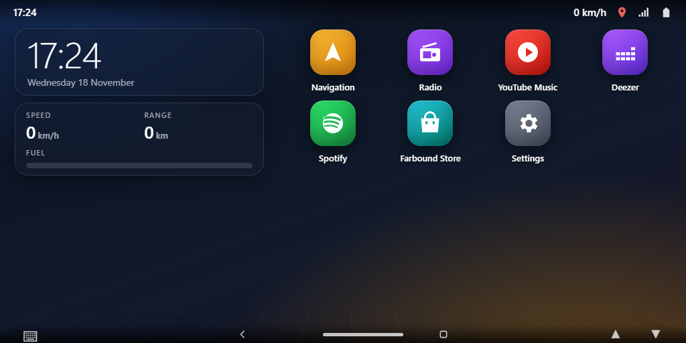
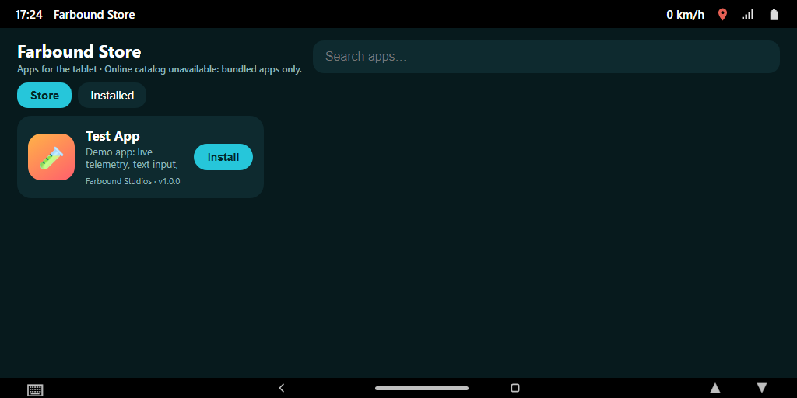
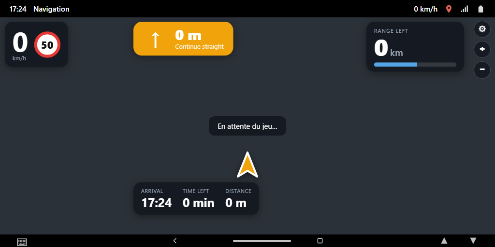
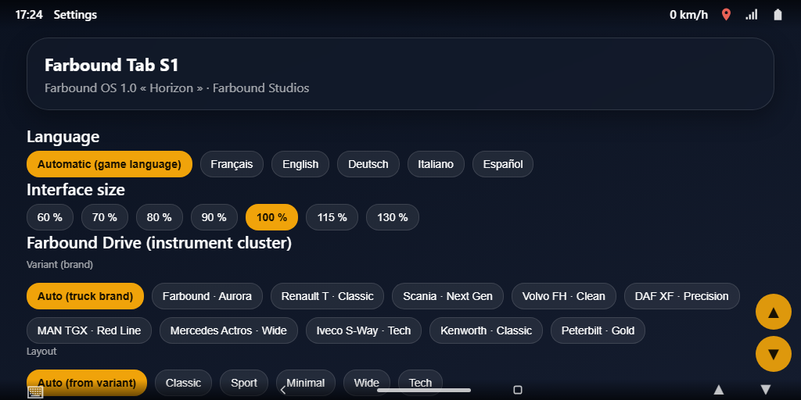
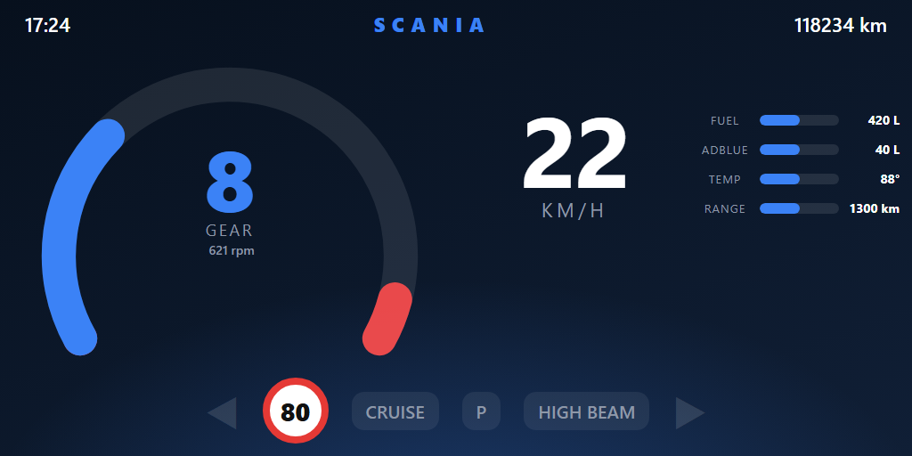
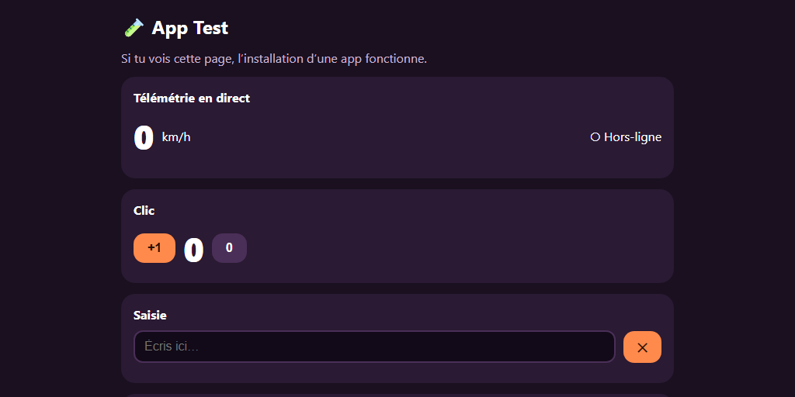

# Farbound Tab

**A realistic in-cab tablet and instrument cluster for Euro Truck Simulator 2** — by **Farbound Studios**.

Farbound Tab replaces the stock GPS screen with a full tablet running **Farbound OS**: a live navigation map taken from the game, a radio that plays the game's stations and your music folder, YouTube Music / Deezer / Spotify, an app store, and a customizable instrument cluster ("Farbound Drive") that adapts to your truck brand.

> The tablet itself is distributed in the [**Releases**](../../releases) tab. This repository's source tree only contains **apps** for the Farbound Store (see [`apps/`](apps)).

| Home | Farbound Store |
|---|---|
|  |  |
| **Navigation** | **Settings** |
|  |  |
| **Farbound Drive (cluster, Scania variant)** | **Test App** |
|  |  |

*(Screenshots are rendered at the tablet's native 1024×512 resolution; the map appears once the game is connected.)*

## Features

- **Navigation** — the game's own GPS map, live, with turn banner, speed/limit, range, ETA. Zoom `+` / `−` and a customization panel (⚙): drag items anywhere, change size, pick a screen style (ETS2, Waze, CarPlay, Android Auto, Night…).
- **Radio** — the game's online stations (`live_streams.sii`, favorites first, language filter) **and** the music from your game `music` folder, with a 🔀 randomize mode.
- **Web apps** — YouTube Music, Deezer, Spotify and any website, in real embedded browser views (WebView2), with page scrolling and a built-in on-screen keyboard.
- **Farbound Store** — install community apps in one click.
- **Farbound Drive** — the instrument cluster, restyled per truck brand and customizable (layout, accent, units, shown items). Players can add variants with a simple `.json` file.
- **Personalization** — wallpaper (presets, color, your own image), free placement of home icons, interface size, 5 languages (FR / EN / DE / IT / ES, default = game language).
- **Real mouse & keyboard** — press **Insert**: the tablet opens as a window over the game; use your mouse and keyboard naturally (game controls are paused). Press Insert again to go back to driving.

## Controls

| Action | Default |
|---|---|
| Open / close the tablet window | `Insert` |
| Move the tablet window | drag with the right mouse button |
| Reload the tablet pages (development) | `F6` |
| Keyboard / gamepad pointer (in-cab) | arrows + `Enter`, remappable in *Settings* |

The game must run in **windowed / borderless** mode for the overlay window to be visible over it.

## Install

1. Download the latest release from the [Releases](../../releases) tab.
2. Copy the plugin DLL and its `.ini` into `Euro Truck Simulator 2\bin\win_x64\plugins\` (create the folder if needed).
3. Start the game; accept the SDK plugin confirmation dialog on the first launch.

Requirements: Windows 10/11, ETS2 (64-bit) with SDK plugin support, the Microsoft WebView2 Runtime (installed with Windows 11 and Edge).

## Create & add your own apps

See **[docs/CREATING_APPS.md](docs/CREATING_APPS.md)** — build an app in plain HTML/JS in a few minutes, test it on your tablet, then publish it to the Farbound Store with a pull request.

## Versions & updates

The tablet and each app are versioned (semver). **Settings → About** checks the [latest release](../../releases/latest) and tells you when a new tablet version is available; the Store shows **Update** on apps with a newer version. Details and the release procedure: [docs/VERSIONING.md](docs/VERSIONING.md) · [CHANGELOG.md](CHANGELOG.md).

## Repository layout

```
apps/                 Store apps (source) + apps/index.json catalog read by the Store
  apptest/            demo app
  _template/          starting point for a new app
docs/                 documentation and images
scripts/validate.js   catalog validator (also run by GitHub Actions)
```

The Store reads `apps/index.json` through jsDelivr: `https://cdn.jsdelivr.net/gh/FarboundStudios/farbound-tab@main/apps/index.json`.

## License

Apps and documentation in this repository: MIT (see [LICENSE](LICENSE)).
The tablet plugin bundles third-party components under their own licenses: MinHook (BSD-2-Clause), Microsoft WebView2 SDK (BSD-3-Clause), SCS SDK (MIT).

*Farbound Tab is an independent project and is not affiliated with SCS Software.*
